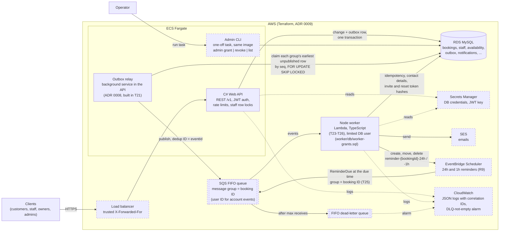
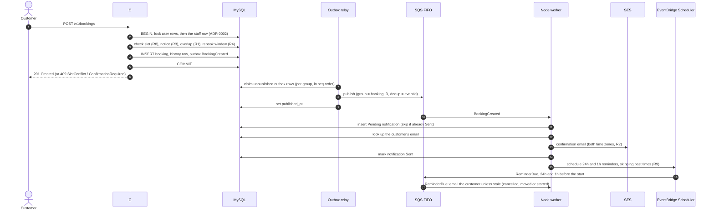

# Architecture

How the booking platform's parts fit together on AWS. The sources are [specs/08-architecture.md](../specs/08-architecture.md), [specs/06-events.md](../specs/06-events.md), [specs/07-nfr.md](../specs/07-nfr.md) and ADRs [0002](adr/0002-booking-concurrency-row-lock.md), [0007](adr/0007-aws-testing-with-fakes.md), [0008](adr/0008-outbox-relay-in-api.md) and [0009](adr/0009-terraform-for-infrastructure.md). Dashed boxes are planned and not built yet; the task that builds each is in [plan/tasks.md](../plan/tasks.md). The AWS services themselves (queue, SES, Scheduler and the rest) are provisioned in T27; the code that talks to them sits behind interfaces with fakes (ADR 0007). Updated 2026-11-24 (T1-T26 built).

## Components

The admin CLI already exists as a command in the API binary (T6); only running it as an ECS task is planned (T27). The API, MySQL, the outbox table and the outbox relay run locally today (Docker Compose for MySQL); the relay publishes only when `Outbox:QueueUrl` is set (it is off in Development without one, and required everywhere else), and its SQS publisher is checked against a real queue by a tagged test once one exists. Everything AWS-specific is provisioned in T27.

## From a request to an email

Creating a booking, as an example of every change that notifies someone.

Delivery is at least once: a crash between publishing and setting `published_at` republishes the row, and the worker's `notifications` table, unique on (event, recipient), stops a second email ([ADR 0008](adr/0008-outbox-relay-in-api.md)). No network call happens inside the transaction that holds the staff lock. Each message group is published in `outbox.seq` order, and a row that fails is retried with backoff (1 s doubling to 60 s), holding back only its own group (decided 2026-11-23).

## Testing seams

Tests never need a live AWS account except the small tagged real-AWS suite ([ADR 0007](adr/0007-aws-testing-with-fakes.md)): the queue publisher, email sender and scheduler sit behind interfaces with in-memory fakes, and integration tests run against a real MySQL in Docker, because the R7 concurrency guarantee can only be tested there.
