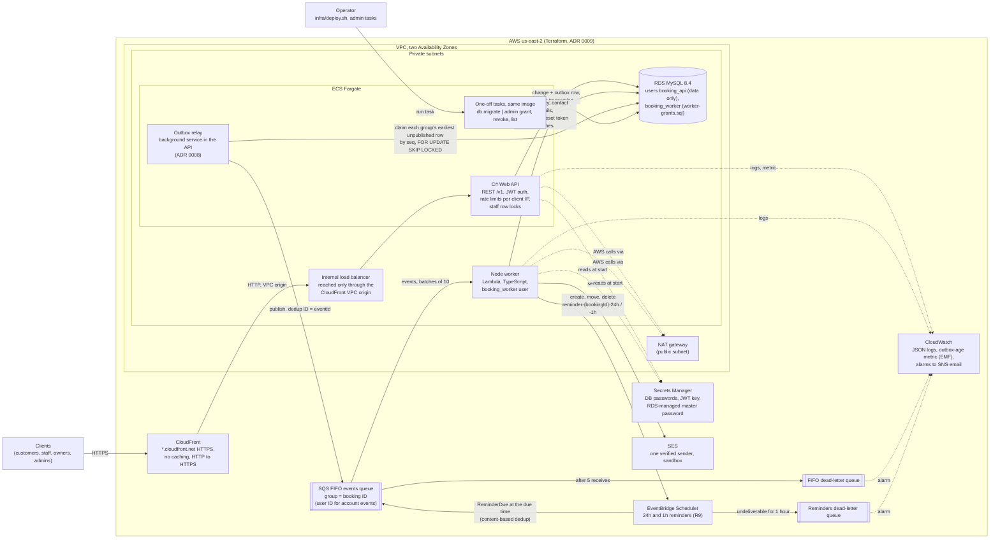
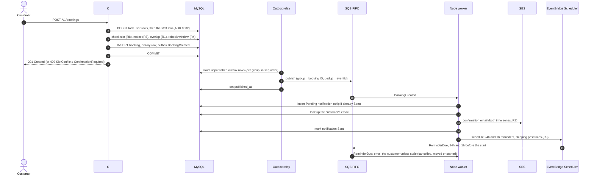

# Architecture

How the booking platform's parts fit together on AWS. The sources are [specs/08-architecture.md](../specs/08-architecture.md), [specs/06-events.md](../specs/06-events.md), [specs/07-nfr.md](../specs/07-nfr.md) and ADRs [0002](adr/0002-booking-concurrency-row-lock.md), [0007](adr/0007-aws-testing-with-fakes.md), [0008](adr/0008-outbox-relay-in-api.md) and [0009](adr/0009-terraform-for-infrastructure.md). Everything shown is built and deployed (dev environment in us-east-2, Terraform in [`infra/`](../infra)); operating it is in the [runbook](runbook.md). Updated 2026-11-25 (T27c, first deployment).

## Components

Network: the load balancer, API tasks, worker Lambda and database have no public addresses. CloudFront reaches the internal load balancer through a VPC origin, and the load balancer's security group admits only CloudFront's origin-facing prefix list. The API and the worker reach SQS, SES, Scheduler and Secrets Manager through one NAT gateway, and the database accepts connections only from the API's and the worker's security groups.

Client IPs: the chain is viewer, CloudFront, load balancer, API. The API trusts the VPC range and CloudFront's origin-facing ranges for `X-Forwarded-For`, two hops back, so rate limits count per viewer and a forged header is ignored (checked on the first deployment, T27c).

IAM, least privilege per role: the API task role may send to the events queue; the worker may send email from the verified sender, create, update and delete schedules in the reminders group, pass the Scheduler role, and read its database secret; the Scheduler role may send to the events queue; the one-off `db migrate` task's execution role may read the RDS master secret and the two users' passwords. The CI role, assumed by GitHub Actions on `main` through OIDC (T27d), may only do what the real-AWS tests do: use the SQS test queue, send from the SES sender, and manage schedules in the reminders group. Database users: `booking_api` has SELECT, INSERT, UPDATE and DELETE (no schema changes); `booking_worker` has exactly the column-level grants in [`worker/db/worker-grants.sql`](../worker/db/worker-grants.sql), which cannot read `password_hash`; both are created and kept in step by `db migrate` before each rollout.

## From a request to an email

Creating a booking, as an example of every change that notifies someone.

Delivery is at least once: a crash between publishing and setting `published_at` republishes the row, and the worker's `notifications` table, unique on (event, recipient), stops a second email ([ADR 0008](adr/0008-outbox-relay-in-api.md)). No network call happens inside the transaction that holds the staff lock. Each message group is published in `outbox.seq` order, and a row that fails is retried with backoff (1 s doubling to 60 s), holding back only its own group (decided 2026-11-23).

## Testing seams

Tests never need a live AWS account except the small tagged real-AWS suite ([ADR 0007](adr/0007-aws-testing-with-fakes.md)): the queue publisher, email sender and scheduler sit behind interfaces with in-memory fakes, and integration tests run against a real MySQL in Docker, because the R7 concurrency guarantee can only be tested there.
